<!-- Hand-made animated SVGs live in ./assets (rebuild: python3 scripts/build_assets.py).
     The GitHub pulse card and snake are rebuilt daily by .github/workflows/profile.yml into the `output` branch. -->

<picture><source media="(prefers-color-scheme: dark)" srcset="./assets/banner-dark.svg" /><source media="(prefers-color-scheme: light)" srcset="./assets/banner-light.svg" /></picture>

<p align="center">
<a href="https://www.linkedin.com/in/sanjay-kumar-9639a6257"><picture><source media="(prefers-color-scheme: dark)" srcset="./assets/btn-linkedin-dark.svg" /><source media="(prefers-color-scheme: light)" srcset="./assets/btn-linkedin-light.svg" /></picture></a>
<a href="mailto:contactsanjaykumar@gmail.com"><picture><source media="(prefers-color-scheme: dark)" srcset="./assets/btn-email-dark.svg" /><source media="(prefers-color-scheme: light)" srcset="./assets/btn-email-light.svg" /></picture></a>
<a href="https://instagram.com/sanjay.o_0"><picture><source media="(prefers-color-scheme: dark)" srcset="./assets/btn-instagram-dark.svg" /><source media="(prefers-color-scheme: light)" srcset="./assets/btn-instagram-light.svg" /></picture></a>
<!-- TODO: replace PORTFOLIO_URL with your portfolio link -->
<a href="PORTFOLIO_URL"><picture><source media="(prefers-color-scheme: dark)" srcset="./assets/btn-portfolio-dark.svg" /><source media="(prefers-color-scheme: light)" srcset="./assets/btn-portfolio-light.svg" /></picture></a>
<a href="https://github.com/clevercroworg"><picture><source media="(prefers-color-scheme: dark)" srcset="./assets/btn-clevercrow-dark.svg" /><source media="(prefers-color-scheme: light)" srcset="./assets/btn-clevercrow-light.svg" /></picture></a>
</p>

<picture><source media="(prefers-color-scheme: dark)" srcset="./assets/header-about-dark.svg" /><source media="(prefers-color-scheme: light)" srcset="./assets/header-about-light.svg" /></picture>

```typescript
const sanjay = {
  role: "Creative Full-Stack Engineer & Digital Architect",
  basedIn: "India",
  buildingAt: "Clever Crow (@clevercroworg)",
  specialization: "Creative full-stack architecture & high-conversion funnels",
  languages: ["TypeScript", "JavaScript (ESNext)", "Python", "Kotlin", "SQL", "GLSL"],
  frontend: ["Next.js 15 (App Router)", "React 19", "Tailwind CSS", "Three.js / WebGL", "Framer Motion"],
  mobile: ["React Native (Expo)", "Android (Kotlin)"],
  backend: ["Django REST Framework", "FastAPI", "Node.js", "PostgreSQL", "Redis"],
  currentlyShipping: ["HealthTracker", "Persona Keyboard"],
  performanceStandard: "100/100 Core Web Vitals · sub-40ms TTFB · 0.000 CLS",
  openTo: "High-impact engineering roles & strategic technical contracts",
};
```

<picture><source media="(prefers-color-scheme: dark)" srcset="./assets/header-stack-dark.svg" /><source media="(prefers-color-scheme: light)" srcset="./assets/header-stack-light.svg" /></picture>

<picture><source media="(prefers-color-scheme: dark)" srcset="./assets/stack-dark.svg" /><source media="(prefers-color-scheme: light)" srcset="./assets/stack-light.svg" /></picture>

<picture><source media="(prefers-color-scheme: dark)" srcset="./assets/header-work-dark.svg" /><source media="(prefers-color-scheme: light)" srcset="./assets/header-work-light.svg" /></picture>

<p align="center">
<a href="https://github.com/clevercroworg/healthtracker-app"><picture><source media="(prefers-color-scheme: dark)" srcset="./assets/project-healthtracker-dark.svg" /><source media="(prefers-color-scheme: light)" srcset="./assets/project-healthtracker-light.svg" /></picture></a>
<a href="https://github.com/SaNjAy-bRo/persona-keyboard"><picture><source media="(prefers-color-scheme: dark)" srcset="./assets/project-persona-keyboard-dark.svg" /><source media="(prefers-color-scheme: light)" srcset="./assets/project-persona-keyboard-light.svg" /></picture></a>
<br/>
<a href="https://www.turboridesupercars.com/"><picture><source media="(prefers-color-scheme: dark)" srcset="./assets/project-turbo-ride-dark.svg" /><source media="(prefers-color-scheme: light)" srcset="./assets/project-turbo-ride-light.svg" /></picture></a>
<a href="https://www.drinkcocofuse.com/"><picture><source media="(prefers-color-scheme: dark)" srcset="./assets/project-cocofuse-dark.svg" /><source media="(prefers-color-scheme: light)" srcset="./assets/project-cocofuse-light.svg" /></picture></a>
<br/>
<a href="https://ssquad.com/"><picture><source media="(prefers-color-scheme: dark)" srcset="./assets/project-ssquad-dark.svg" /><source media="(prefers-color-scheme: light)" srcset="./assets/project-ssquad-light.svg" /></picture></a>
<a href="https://yachtclubindia.com/"><picture><source media="(prefers-color-scheme: dark)" srcset="./assets/project-yacht-club-dark.svg" /><source media="(prefers-color-scheme: light)" srcset="./assets/project-yacht-club-light.svg" /></picture></a>
<br/>
<a href="https://www.tanubhi.com/"><picture><source media="(prefers-color-scheme: dark)" srcset="./assets/project-tanubhi-dark.svg" /><source media="(prefers-color-scheme: light)" srcset="./assets/project-tanubhi-light.svg" /></picture></a>
<a href="https://clevercrow.in"><picture><source media="(prefers-color-scheme: dark)" srcset="./assets/project-clever-crow-dark.svg" /><source media="(prefers-color-scheme: light)" srcset="./assets/project-clever-crow-light.svg" /></picture></a>
</p>

<picture><source media="(prefers-color-scheme: dark)" srcset="./assets/header-pulse-dark.svg" /><source media="(prefers-color-scheme: light)" srcset="./assets/header-pulse-light.svg" /></picture>

<picture><source media="(prefers-color-scheme: dark)" srcset="https://raw.githubusercontent.com/SaNjAy-bRo/SaNjAy-bRo/output/pulse-dark.svg" /><source media="(prefers-color-scheme: light)" srcset="https://raw.githubusercontent.com/SaNjAy-bRo/SaNjAy-bRo/output/pulse-light.svg" /></picture>

<picture><source media="(prefers-color-scheme: dark)" srcset="https://raw.githubusercontent.com/SaNjAy-bRo/SaNjAy-bRo/output/snake-dark.svg" /><source media="(prefers-color-scheme: light)" srcset="https://raw.githubusercontent.com/SaNjAy-bRo/SaNjAy-bRo/output/snake-light.svg" /></picture>

<picture><source media="(prefers-color-scheme: dark)" srcset="./assets/header-words-dark.svg" /><source media="(prefers-color-scheme: light)" srcset="./assets/header-words-light.svg" /></picture>

<picture><source media="(prefers-color-scheme: dark)" srcset="./assets/quote-dark.svg" /><source media="(prefers-color-scheme: light)" srcset="./assets/quote-light.svg" />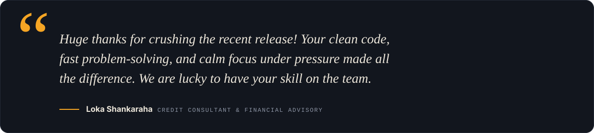</picture>

<picture><source media="(prefers-color-scheme: dark)" srcset="./assets/header-contact-dark.svg" /><source media="(prefers-color-scheme: light)" srcset="./assets/header-contact-light.svg" /></picture>

<p align="center">
Launching a flagship platform, speeding up checkout, or building something immersive in 3D?<br/>
<b><a href="mailto:contactsanjaykumar@gmail.com">Send an email</a></b> · <b><a href="https://www.linkedin.com/in/sanjay-kumar-9639a6257">Connect on LinkedIn</a></b> · <b><a href="https://instagram.com/sanjay.o_0">Follow on Instagram</a></b>
</p>

<picture><source media="(prefers-color-scheme: dark)" srcset="./assets/footer-dark.svg" /><source media="(prefers-color-scheme: light)" srcset="./assets/footer-light.svg" /></picture>
