<!-- Animated SVGs live in ./assets (built by scripts/build_assets.py).
     Live stats + snake are rebuilt daily by .github/workflows/profile.yml into the `output` branch. -->

<div align="center">

<picture><source media="(prefers-color-scheme: dark)" srcset="./assets/banner-dark.svg" /><source media="(prefers-color-scheme: light)" srcset="./assets/banner-light.svg" /></picture>

<br/>

<a href="https://www.linkedin.com/in/sanjay-kumar-9639a6257"></a>
<a href="mailto:contactsanjaykumar@gmail.com"></a>
<a href="https://instagram.com/sanjay.o_0"></a>
<!-- TODO: replace PORTFOLIO_URL with your portfolio link -->
<a href="PORTFOLIO_URL"></a>
<a href="https://github.com/clevercroworg"></a>


</div>


```typescript
const sanjay = {
  role: "Creative Full-Stack Engineer & Digital Architect",
  basedIn: "India",
  buildingAt: "Clever Crow (@clevercroworg)",
  specialization: "Creative full-stack architecture & high-conversion funnels",
  languages: ["TypeScript", "JavaScript (ESNext)", "Python", "Kotlin", "SQL", "GLSL"],
  frontend: ["Next.js 15 (App Router)", "React 19", "Tailwind CSS", "Three.js / WebGL", "Framer Motion"],
  mobile: ["React Native (Expo)", "Android (Kotlin)"],
  backend: ["Django REST Framework", "FastAPI", "Node.js", "PostgreSQL", "Redis"],
  currentlyShipping: ["HealthTracker", "Persona Keyboard"],
  performanceStandard: "100/100 Core Web Vitals · sub-40ms TTFB · 0.000 CLS",
  openTo: "High-impact engineering roles & strategic technical contracts",
};
```


<div align="center">

<sub><b>FRONTEND &amp; CREATIVE 3D</b></sub><br/>
<picture><source media="(prefers-color-scheme: dark)" srcset="https://skillicons.dev/icons?i=react,nextjs,typescript,javascript,tailwind,html,css,threejs,vite&perline=10&theme=dark" /><source media="(prefers-color-scheme: light)" srcset="https://skillicons.dev/icons?i=react,nextjs,typescript,javascript,tailwind,html,css,threejs,vite&perline=10&theme=light" /></picture>

<sub><b>BACKEND &amp; DATA</b></sub><br/>
<picture><source media="(prefers-color-scheme: dark)" srcset="https://skillicons.dev/icons?i=python,django,fastapi,nodejs,postgres,redis,graphql,mongodb&perline=10&theme=dark" /><source media="(prefers-color-scheme: light)" srcset="https://skillicons.dev/icons?i=python,django,fastapi,nodejs,postgres,redis,graphql,mongodb&perline=10&theme=light" /></picture>

<sub><b>MOBILE</b></sub><br/>
<picture><source media="(prefers-color-scheme: dark)" srcset="https://skillicons.dev/icons?i=react,kotlin,androidstudio&perline=10&theme=dark" /><source media="(prefers-color-scheme: light)" srcset="https://skillicons.dev/icons?i=react,kotlin,androidstudio&perline=10&theme=light" /></picture>

<sub><b>CLOUD, DEVOPS &amp; TOOLING</b></sub><br/>
<picture><source media="(prefers-color-scheme: dark)" srcset="https://skillicons.dev/icons?i=docker,aws,cloudflare,vercel,git,github,vscode,figma,postman&perline=10&theme=dark" /><source media="(prefers-color-scheme: light)" srcset="https://skillicons.dev/icons?i=docker,aws,cloudflare,vercel,git,github,vscode,figma,postman&perline=10&theme=light" /></picture>

</div>


<div align="center">
  <a href="https://github.com/clevercroworg/healthtracker-app"><picture><source media="(prefers-color-scheme: dark)" srcset="./assets/project-healthtracker-dark.svg" /><source media="(prefers-color-scheme: light)" srcset="./assets/project-healthtracker-light.svg" /></picture></a>
  <a href="https://github.com/SaNjAy-bRo/persona-keyboard"><picture><source media="(prefers-color-scheme: dark)" srcset="./assets/project-persona-keyboard-dark.svg" /><source media="(prefers-color-scheme: light)" srcset="./assets/project-persona-keyboard-light.svg" /></picture></a>
  <br/>
  <a href="https://www.turboridesupercars.com/"><picture><source media="(prefers-color-scheme: dark)" srcset="./assets/project-turbo-ride-dark.svg" /><source media="(prefers-color-scheme: light)" srcset="./assets/project-turbo-ride-light.svg" /></picture></a>
  <a href="https://www.drinkcocofuse.com/"><picture><source media="(prefers-color-scheme: dark)" srcset="./assets/project-cocofuse-dark.svg" /><source media="(prefers-color-scheme: light)" srcset="./assets/project-cocofuse-light.svg" /></picture></a>
  <br/>
  <a href="https://ssquad.com/"><picture><source media="(prefers-color-scheme: dark)" srcset="./assets/project-ssquad-dark.svg" /><source media="(prefers-color-scheme: light)" srcset="./assets/project-ssquad-light.svg" /></picture></a>
  <a href="https://yachtclubindia.com/"><picture><source media="(prefers-color-scheme: dark)" srcset="./assets/project-yacht-club-dark.svg" /><source media="(prefers-color-scheme: light)" srcset="./assets/project-yacht-club-light.svg" /></picture></a>
  <br/>
  <a href="https://www.tanubhi.com/"><picture><source media="(prefers-color-scheme: dark)" srcset="./assets/project-tanubhi-dark.svg" /><source media="(prefers-color-scheme: light)" srcset="./assets/project-tanubhi-light.svg" /></picture></a>
  <a href="https://clevercrow.in"><picture><source media="(prefers-color-scheme: dark)" srcset="./assets/project-clever-crow-dark.svg" /><source media="(prefers-color-scheme: light)" srcset="./assets/project-clever-crow-light.svg" /></picture></a>
</div>


<div align="center">

<picture><source media="(prefers-color-scheme: dark)" srcset="https://raw.githubusercontent.com/SaNjAy-bRo/SaNjAy-bRo/output/pulse-dark.svg" /><source media="(prefers-color-scheme: light)" srcset="https://raw.githubusercontent.com/SaNjAy-bRo/SaNjAy-bRo/output/pulse-light.svg" /></picture>

<picture><source media="(prefers-color-scheme: dark)" srcset="https://raw.githubusercontent.com/SaNjAy-bRo/SaNjAy-bRo/output/snake-dark.svg" /><source media="(prefers-color-scheme: light)" srcset="https://raw.githubusercontent.com/SaNjAy-bRo/SaNjAy-bRo/output/snake-light.svg" /></picture>

</div>


> [!NOTE]
> **"Huge thanks for crushing the recent release! Your clean code, fast problem-solving, and calm focus under pressure made all the difference. We are lucky to have your skill on the team."**
>
> — **Loka Shankaraha**, *Credit Consultant & Financial Advisory*


<div align="center">

Launching a flagship platform, speeding up checkout, or building something immersive in 3D? Let's talk.

**[Send an email](mailto:contactsanjaykumar@gmail.com)** · **[Connect on LinkedIn](https://www.linkedin.com/in/sanjay-kumar-9639a6257)** · **[Follow on Instagram](https://instagram.com/sanjay.o_0)**

<br/>

<picture><source media="(prefers-color-scheme: dark)" srcset="./assets/footer-dark.svg" /><source media="(prefers-color-scheme: light)" srcset="./assets/footer-light.svg" />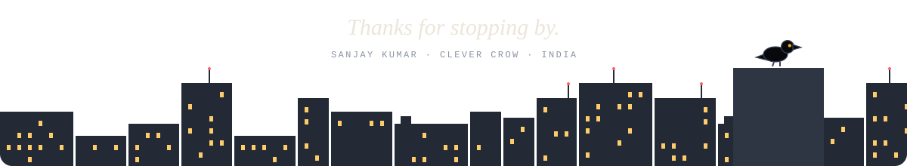</picture>

</div>
